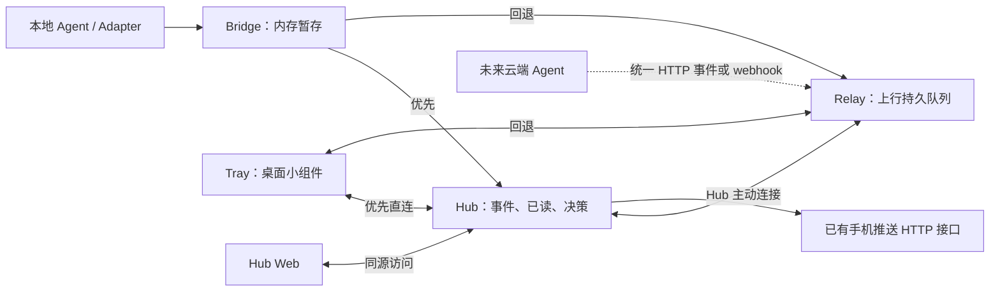

# AgentPulse 实现设计

依据：[需求文档](agent-pulse-requirements.md)。本文按个人单用户、可信内网、少量主机和低频通知设计。参数默认值按真实运行调整；框架选择以目标平台验证为依据。实施进度见 [开发记录](development-status.md)，文档变更见 [变更记录](../CHANGELOG.md)。

## 1. 术语与设计原则

| 名称 | 白话定义 |
| --- | --- |
| Hub（会话中心） | 保存会话、事件和已读状态，决定是否发送手机通知 |
| Relay（公网中继） | 无法直连 Hub 时暂存上行数据，并转发双方通信 |
| Bridge（本地接入进程） | 接收本地 Agent 事件，在内存排队并负责网络重试 |
| Adapter（来源适配器） | 将某个 Agent 的原始事件转换成统一格式 |
| Tray（桌面小组件） | 托盘、会话列表、提醒及设备状态上报；首版 Windows |
| 快照 | Hub 当前的会话、未读和设备状态集合，重连时重新取得 |
| 幂等 | 同一事件重发多次，只保存和触发一次业务处理 |

直接实现当前功能。只有 Agent 接入、桌面系统调用、手机 HTTP 请求三处保留明确替换边界；不建设通用插件平台、账号权限系统或消息同步框架。

保留稳定事件 ID、已读同步、服务端必要持久化和断线恢复，因为它们直接对应需求。简化主要靠减少状态副本、模块和协议机制，不靠删掉故障保证。

## 2. 多语言目录和 Go module

根目录放 `go.mod` 技术上完全可行，Go 工具不把 TypeScript 或 C# 项目当 Go 包处理。[Go 官方布局指南](https://go.dev/doc/modules/layout)也展示了含非 Go 目录的服务端仓库。本工程使用 `go/` 子目录组织 Go 代码，使多语言入口和工具边界清晰。

```text
agent-pulse/
├── README.md
├── go/
│   ├── go.mod                    Hub/Relay/Bridge 共用一个 module
│   ├── cmd/
│   │   ├── agent-pulse-hub/
│   │   ├── agent-pulse-relay/
│   │   └── agent-pulse-bridge/
│   ├── protocol/                 Go 事件与消息类型，不含数据库代码
│   └── internal/
│       ├── config/               配置加载，含可选共享令牌
│       ├── event/                事件校验、会话状态规则
│       ├── hub/                  Hub 业务及其 SQLite 操作
│       ├── relay/                转发和一张待发送队列表
│       ├── bridge/               本地入口、内存队列
│       ├── adapters/             签名包下载、安装、回滚与运行入口
│       ├── notify/               HTTP 手机推送
│       └── transport/            HTTP/WS 连接、退避
├── protocol/                     跨语言 JSON 示例和协议说明
├── web/hub/                      Vue 3 + TypeScript + Vite，独立前端工程
├── adapters/{opencode,codex,antigravity,qoderclicn,zcode}/
├── tray/                         桌面小组件，框架验证后初始化
├── deploy/{docker,compose,proxy,systemd}/
├── scripts/
├── tests/{contract,integration,e2e}/
└── docs/
```

三个 Go 程序共用依赖，不按服务分别拆 module。各组件 SQL 留在自身目录，不预建通用仓储和依赖注入层；跨语言契约是 JSON 数据，不导出数据库表。现有 module 名 `agent-pulse` 仅用于仓库内部构建，不作为外部 Go 库发布；GitHub 仓库地址不要求改写内部导入路径。

Tray 首选 Rust + GPUI，在 `tray/` 用 Cargo 独立构建，通过 JSON 协议与 Go 服务通信，不把 Go 库嵌入 UI 进程。只有 GPUI 验证不可行时才在该目录建立 Go + Walk 工程；届时按需用独立 module 和 `go.work` 隔离 GUI 依赖并共享少量协议类型。不会同时维护两套桌面工程。前端使用 Volta 管理环境、pnpm 管理依赖，桌面开发工具在原型阶段准备。

## 3. Tray 技术路线与验证

Tray 是小型常驻桌面组件，同时作为尝试 GPUI 的实际载体。技术路线为 **Rust + GPUI 优先，验证不可行时采用 Go + Walk**。采用首选并不以它比所有备选更省资源为前提；可行性、学习价值、使用体验和维护成本共同决定是否继续。

| 条件 | 实施选择 | 范围 |
| --- | --- | --- |
| GPUI 满足关键交互与运行要求 | Rust + GPUI | 完成托盘、提醒卡片、会话/未读列表及客户端同步 |
| GPUI 有明确、难以合理解决的阻碍 | Go + Walk | 实现同样的 Windows 功能，沿用 JSON 协议 |

Tray 自己提供桌面交互，不采用浏览器、WebView 页面或打开 Hub Web 代替提醒和列表。Hub Web 仍用于独立的服务端管理，不承担 Tray 的交互。Flutter、Wails、C# 不作为此技术路线的后备选项。

### 3.1 实现与依赖边界

- Rust + GPUI：在 `tray/` 独立 Cargo 工程中固定 Rust 工具链、依赖版本及锁文件；当前使用 GPUI 0.2.2 与 tray-icon 0.26.1，通过事件通道接入同一 UI 线程。少量 Win32 函数处理禁止激活卡片、隐藏窗口初始布局和子进程生命周期，不维护 GPUI 分叉。[GPUI 官方说明](https://github.com/zed-industries/zed/tree/main/crates/gpui)用于核对后续版本兼容性。
- Go + Walk：仅在触发后备条件时开发，使用 [Walk 的原生窗口与托盘能力](https://github.com/lxn/walk/tree/master/examples/notifyicon)，补充少量必要的 Windows 系统调用。Windows 原生界面与连接/未读逻辑分开，为未来其他桌面平台保留替换边界，不假定 Walk 本身跨平台。
- Tray 内只分连接/未读状态、UI、平台函数。协议和缓存与渲染实现无关；锁屏/全屏、窗口显示、自启动与 Bridge 子进程管理集中在平台代码中。

### 3.2 GPUI 原型的通过与停止条件

原型只包含托盘、不会抢焦点的提醒卡片、简单列表和模拟数据，验证隐藏驻留、托盘点击、退出、锁屏/解锁、全屏降级、置顶、多显示器/DPI、中文文本及常用远程桌面环境。Windows 是首个验收平台，Linux 构建或模拟不能代替原生验证。

发布构建记录冷启动、闲置/提醒时的内存与 CPU/GPU、唤醒频率、包体积和环境准备步骤。关键交互正确、后台无无意义持续重绘、依赖可固定并维护时，继续用 Rust 实现 Tray。实际结果记录在开发验证文档，不能预先宣称比 Go 实现更轻。

只有遇到关键桌面行为无法实现、目标环境不能稳定运行，或需要长期维护大规模框架分叉等明确阻碍时，记录复现与原因，转入 Go + Walk。Rust 学习成本、陌生 API 或一次普通构建失败不是立即放弃首选的理由。不同时构建多个完整客户端做框架竞赛。

### 3.3 Bridge 的后续 Rust 评估

Bridge 首版继续使用 Go，GPUI 是否通过不阻塞 Linux 服务端和适配器开发。GPUI 可行并采用 Rust Tray 后，可以再评估 Rust 对 Bridge 是否有实际资源收益；这属于后续技术选项，不是立即重写计划，也不扩大到 Hub/Relay。

比较必须针对 Bridge 的等价功能：相同平台、发布构建、连接数、心跳、事件大小/速率、队列上限和重试策略，覆盖闲置、持续收事件、断网积压与恢复。记录常驻/峰值内存、CPU、启动时间、投递延迟和包体积，结合开发维护成本判断收益。不能把 Rust Tray 与 Go Bridge 的内存直接比较，再归因于语言。

只有测量支持有实际收益且替换成本合理时，才提出迁移实现。迁移应保持事件协议、稳定 hook 入口、Adapter 包兼容性及独立更新机制，保留回退方式；不会为预期中的 Rust 版本提前重排仓库或维护两套 Bridge。macOS/Linux Tray 仍仅保留扩展边界，首版交付 Windows amd64。

## 4. 通信与最小状态模型



Bridge 的 HTTP 提交优先直连 Hub，网络错误或 5xx 时回退 Relay，失败按 1–30 秒退避重试。设备状态连接同样优先 Hub；经 Relay 连接最多保持 30 秒，再尝试直连。每台 Bridge 只保留一条状态连接，切换时重复消息靠业务 ID 去重。Tray 沿用优先直连、失败回退和重连取快照的协议，桌面具体连接策略在原型中验证。

Hub 主动连接 Relay，内网不开放公网入站口。HTTP 负责提交/查询，WebSocket 负责设备心跳、变化通知和中继双向请求。不要让每条事件同时经过两条活动路径。

### 4.1 统一事件

```json
{
  "event_id": "stable-source-event-id",
  "source_id": "workstation-wsl-or-cloud-workspace",
  "agent": "opencode",
  "session_id": "native-main-session-id",
  "kind": "input.required",
  "occurred_at": "2026-11-09T10:00:00Z",
  "title": "等待选择下一步",
  "body": "请选择执行方案",
  "project": "agent-pulse",
  "scope": "main"
}
```

必填：事件 ID、来源 ID、Agent、会话 ID、类型、时间、非空标题和主代理标识；正文允许为空，项目名等展示信息可选。`source_id` 是可观察环境，不一定是物理主机。会话主键是 `(source_id, agent, session_id)`。来源 ID 是区分记录的标识，不是账号或权限。

原生有事件 ID 时与来源组合生成稳定 ID；没有则适配器首次观察时生成随机 ID，整个重试过程复用。相同 ID 相同业务内容重复提交返回成功；同 ID 内容冲突返回错误。可选原生序号用于拒绝旧状态覆盖新状态；没有可靠顺序的历史补报只进历史，不凭客户端时间覆盖当前会话。

| 事件 | 会话变化 | 强提醒 |
| --- | --- | --- |
| `session.started` / `session.resumed` / `activity.observed` | 运行中 | 否 |
| `turn.completed` / `task.completed` | 空闲，可继续会话 | 是，保留两者语义区别 |
| `input.required` / `approval.required` | 等待用户/批准 | 是，通知不能执行批准 |
| `tool.failed` | 不自动判主会话失败 | 默认否 |
| `run.failed` / `run.interrupted` | 失败/中断，可后续恢复 | 是 |
| `session.closed` | 关闭 | 默认否 |
| 无法继续观察 | 未知/失联 | 弱状态提示，不猜测成功或失败 |

只纳入主代理。适配器先过滤，接收入口再校验；范围不明时记录能力缺口，不把它默认作为主代理创建条目。可靠关联到同一完成动作时可合并提醒，不能按相同正文去重不同事件。

### 4.2 最小接口

| 接口 | 用途 |
| --- | --- |
| `POST /api/v1/events` | 接收统一事件，Hub/Relay 使用相同格式 |
| `POST /api/v1/read` | 标记一组 event_id 已读；重复提交无副作用 |
| `GET /api/v1/snapshot` | 当前会话、设备、全部未读及其提醒有效性；历史另行分页查询 |
| `GET /api/v1/events` | 事件历史/详情分页 |
| `GET /api/v1/connect` | Bridge/Tray/Web 建立 WS 连接 |
| `GET /api/v1/relay` | Hub 主动向 Relay 建立 WS 连接 |
| `GET /api/v1/push-jobs` | 最近 200 条手机发送记录 |
| `GET /api/v1/adapters/index` / `packages/{hash}` | 签名索引与支持 Range 的只读包下载 |
| `GET/POST /api/v1/adapters/status` | 主机适配器报告查询/上报 |
| `GET /healthz` | 本地进程状态；断开对端不触发容器反复重启 |

协议版本体现在 URL；WS 使用简单的 `{type, request_id, payload}`，只定义 hello、heartbeat、state、changed、snapshot、ack、error 等实际消息。request_id 只关联当前请求，不作为永久消息身份。HTTP 错误沿用 400/401/409/413/503，错误体说明原因及是否可重试。

提交响应区分 HTTP 200（Hub 已提交）与 202（Relay 已落盘待转交），并在 WS 确认中保留相同含义。Bridge 收到任一结果可释放事件内存；Tray 的离线已读只有在 Hub 确认后才移出待同步集合。确认丢失时重复提交即可，不增加新的永久操作 ID。

设备每 10 秒心跳，35 秒未更新标离线；锁屏、解锁、全屏即时上报。Hub 重启或与 Relay 断开后，不把历史心跳显示为实时在线。旧连接关闭不能把已接入新连接的设备标离线；保存当前连接引用即可，无需单独租约服务。

## 5. 持久化与重连：只保存不可重建的数据

### 5.1 各组件存什么

| 位置 | 最小存储 | 必要性 |
| --- | --- | --- |
| Hub | SQLite：`sessions`、`events`、`reads`、`push_jobs`、`adapter_hosts` | 会话/历史、已读、推送任务和离线主机最近一次适配器报告 |
| Relay | SQLite：一张 `pending` 上行队列表 | Hub 离线时接收的数据，Relay 重启后仍能补发 |
| Bridge | 有界内存队列 | 按原需求不要求进程退出恢复 |
| Tray | 一个本地状态文件 | 当前缓存、离线已读、已经提醒的 ID；历史以 Hub 为准 |

SQLite 是进程内数据库文件，不需要单独数据库服务器。[SQLite 官方用途说明](https://www.sqlite.org/whentouse.html)将其用于应用本地存储。Relay 使用它的原因只有可靠暂存：Bridge 收到接收确认后会释放内存，Relay 必须承担这部分数据的恢复责任。改用内存会降低现有保证；手写文件队列还得处理部分写入、恢复和确认删除，未必更省事。

Relay `pending` 保存本地自增序号、业务去重键、接口路径、JSON 载荷及阻塞标记。接收事务提交后才确认；Hub 返回 200 后删行；400/409/413 将该行保留并标为阻塞，不阻挡其他项，通过健康接口报告数量。Hub 已处理但 Relay 来不及删，重启重发仍由 Hub 去重。提交失败/容量满返回失败，不确认、不静默清理已接收项。只保证正常软件/存储条件下的持久性，硬件损坏依靠备份。

下行事件、查询回复和设备状态不在 Relay 持久化；Hub 已保存权威数据，断线后 Tray 重新同步即可。设备心跳只保留当前连接的最新值，Hub 恢复后重新取在线状态，不回放过期心跳。Relay 不维护会话、已读视图、独立游标表或双向持久队列。

Hub 事务保存事件、会话更新和对应推送任务后返回成功；重复事件不重复创建任务。`reads` 以 event_id 为唯一键，允许早于事件到达。没有用户/凭据/角色表，没有通用 outbox（额外保存所有待发送消息的表）或持久化变化日志。推送任务唯一键为事件 ID 与渠道名。

Tray 状态文件使用单写入者、临时文件写入后同步并原子替换；启动读回。离线已读操作须落盘后才算保存成功，失败时提示。缓存只保存当前视图及必要提醒 ID，历史按需读 Hub；替换快照不能丢掉尚未获 Hub 确认的已读操作。若未来数据量或文件一致性成本证明需要 SQLite，再替换这一处存储。

### 5.2 恢复流程

1. Tray 重连或解锁时暂停自动弹出，先提交本地待同步已读。经 Relay 时，暂存成功不代表 Hub 已应用，保留本地操作直到 Hub 确认。
2. 在已建立变化订阅的连接上获取当前快照。Hub 用串行状态处理或短事务形成一致视图；同步期间发生变化则再刷新，不需要回放完整历史消息。
3. 快照带 Hub 本次运行标识与状态版本号。WS `changed` 只表示“状态变了，请刷新”；客户端合并频繁刷新，响应旧于已收到版本时继续刷新。版本不持久化，Hub 重启强制全量刷新。
4. 同步完成后，仅展示仍有效、未读、且本机未提醒的事件。新读状态清除提醒，不删除进行中会话。

完整未读和当前会话属于快照；历史分页不参与恢复屏障。首版按个人规模传完整当前视图，如果超限则明确报错而非截断后宣称已同步；真遇到规模问题再加分页快照。连接阻塞或漏心跳则关闭重连重新取状态，避免用复杂增量确认修补连接。

客户端以完整快照重建未读集合，不能只追加新事件，否则在其他设备读过的旧提醒会残留。本地未确认已读继续覆盖展示结果；历史详情的精确已读状态按需查询。已失效但尚未读的事件仍可出现在列表，不能再自动弹出。

Relay 将快照/查询原样请求 Hub 并关联回复，不缓存旧结果冒充最新；Hub 不可达时 Tray 可浏览已有缓存、保存已读，但不重新弹出旧提醒。Web 使用相同的“变化通知 + 刷新”策略。

业务去重使用已有标识：已读以 event_id 幂等；事件以 event_id 幂等；查询用临时 request_id。来源设备 ID 只用于状态归属和诊断。

### 5.3 提醒边界

收到数据、显示窗口、用户已读是三件事。只在打开详情或明确标记时设为已读；解锁和弹窗不自动算已读。

本机已提醒 ID 在调起提醒前保存，避免崩溃后重复弹出；此时若崩溃可能漏一次自动弹出，但事件仍在未读列表。显示完成可另存时间，不把尝试误记为已读。允许在列表主动重看。

SQLite 仅用本地 Docker 数据卷；依靠事务和显式迁移，不自建数据库框架。备份使用数据库备份能力或停服务后复制完整文件；恢复后所有客户端刷新，丢弃在线状态。首版不自动删除未读、未确认队列、已读标记和去重 ID；历史正文清理另行设计，不先规定多套保留周期。

## 6. 通知规则与普通 HTTP 推送

所有在线 Tray 接收状态。至少一台在线且未锁屏则不发手机；全部锁屏或无在线设备则发送标题和精简正文。全屏仍算未锁屏，只显示小标识或延迟完整窗口。未知/过期的设备状态不能作为“用户在电脑前”的依据。

Hub 恢复后先接受最新设备状态和已读，再处理积压任务；实际发送前重新检查是否已读/已失效。等待用户的事件在明确后续活动或会话关闭后失效；正常会话关闭保留已生成的完成、失败和中断提醒，避免短命令退出后漏推。未观察过的会话只收到关闭事件时仅存历史，不创建列表项。过旧提醒可配置有效期，失效不删除历史。积压在 Tray 按会话合并显示，不堆叠大量弹窗。

手机推送只做一个 HTTP 发送器。配置请求方法、URL、headers、query 参数，以及 JSON 或表单 body；变量仅提供标题、正文和必要渠道配置。用标准 URL/JSON/表单编码，不做任意脚本执行、可编程表达式或通用工作流。

渠道可分别配置标题和正文的 Unicode 字符上限，默认不限制；仅在发送时截短变量值并添加计入上限的省略号，不改变 Hub 保存的事件或 Tray 内容。不同渠道独立处理，不固定任何服务的专有阈值。参数及计数边界见 [手机 HTTP 渠道](linux-quickstart.md#手机-http-渠道)。

单个渠道的配置结构如下，在 Hub 配置中置于 `push` 列表。可运行配置和当前渠道限制见 [Linux 运行说明](linux-quickstart.md)：

```yaml
name: my-phone
method: POST
url: "https://push.example.invalid/send"
format: json
headers:
  Authorization: "Bearer ${env:PUSH_TOKEN}"
fields:
  title: "${title}"
  content: "${body}"
timeout_seconds: 5
```

GET 使用 query 参数，POST 可用 query/JSON/表单；字段名直接适配现有服务。需要特殊签名或解析业务成功码时，只为那个渠道增加短函数，不为所有渠道搭建插件系统。不固定 ntfy，也不要求自建推送服务；首版选择用户已有渠道做一次真实手机验证。

当前 `push` 列表按渠道分别创建任务，是向各渠道分别发送，不是按优先级选择或故障切换。优先级策略留待后续明确需求再实现。返回 HTTP 2xx 但另有业务结果的接口，通过局部适配判断成功、失败或结果未知，不根据响应文本猜测成功。其他通用 HTTP 渠道仍以 2xx 为接收成功，不能据此证明手机实收。使用者按所选渠道的官方文档和实测结果配置参数，不将某一渠道的限制固化为所有部署的规则。

后台任务表避免重复生成；明确失败有限重试并记录，不能阻塞 Agent。HTTP 成功但业务码失败按该渠道规则处理；请求超时后无法确认是否送达时标记结果不确定，默认不盲目重发。普通第三方 HTTP 接口无法在没有渠道幂等支持时承诺绝对不重复。日志不记录含 token 的 URL、headers 或正文。

## 7. 安全措施与本地配置

### 7.1 按部署位置区分

| 位置 | 首版方案 |
| --- | --- |
| 可信内网 Hub / Web | 默认无登录、无账号角色；限制为用户指定的可信内网入口 |
| 公网 Relay | HTTPS/WSS + 一个配置的随机共享令牌；缺令牌则拒绝启动公网服务 |
| 内网访问控制可选项 | 需要时由现有反向代理提供认证或配置共享令牌，不自建账号系统 |
| 本地 Bridge | 默认仅 loopback HTTP，接受 JSON，限制请求体并拒绝不匹配的浏览器 Origin |
| 未来公网 webhook | 按来源校验平台签名或单独接入令牌，仅允许提交事件 |

HTTPS/TLS 保护传输，普通 HTTPS 不限制谁可以调用接口；公网仍需最小访问控制。其职责区别见 [TLS 说明](https://developer.mozilla.org/en-US/docs/Web/Security/Defenses/Transport_Layer_Security)。同样，TLS 不保护磁盘里的配置，但个人电脑首版无需因此强制引入凭据保险库。

共享令牌只是配置字段和一段中间件，不做设备注册、角色权限、token 数据表、发放/刷新/撤销平台。使用同一公网令牌的设备视为同一信任域。内网免登录意味着能访问该入口的人可读取/标记数据，部署范围需与这个假设相符。

Relay 客户端是原生 Bridge/Tray，用 HTTP/WS header 传令牌；浏览器 Web 首版只同源访问 Hub，不增加跨 Relay 的 Web 登录协议。Hub Web 采用 Vue 3 + TypeScript + Vite，静态文件随 Hub 部署；展示会话、设备、适配器、推送和历史，支持明确标记已读。页面资源允许访问，启用 Hub 令牌后 API 需要令牌；用户输入只驻留页面内存，HTTP 用 Authorization，WebSocket 用子协议携带，不放 URL 或浏览器持久存储。页面与 API 按相同入口部署；禁用宽泛 CORS，变更接口使用 JSON 并检查浏览器 Origin，避免外部网页跨站调用。

### 7.2 YAML 配置与本地保存

人工维护的配置统一使用 YAML：嵌套 HTTP 参数、渠道列表、适配器启用项可以直接按层次表达，也与 Compose 示例保持一致。TOML 同样能够表达这些数据且类型规则较直观；选择 YAML 是针对本工程的编辑体验，不是宣称它普遍更好。[YAML 规范](https://yaml.org/spec/1.2.2/)与 [TOML 规范](https://toml.io/en/v1.0.0)用于核对语法，项目只支持一种人工配置格式。

配置使用 YAML 的简单子集：单文档、字符串键、普通映射/列表/标量。采用成熟解析库，拒绝重复键、未知字段、自定义标签及锚点/别名/合并键；类型严格校验，版本号、URL、令牌和占位符按字符串处理。缺少必需值或解析失败时给出文件位置和字段名，不打印敏感值。不建设配置继承、远程 include 或表达式语言。

`${env:NAME}` 仅用于显式读取环境变量，先解析 YAML、再替换指定字符串值，避免环境值改变 YAML 结构。通知模板中的 `${title}` / `${body}` 仅在发送时替换，使用 JSON/URL/表单编码而非字符串拼接请求。变量缺失返回错误，不能悄悄变成空值。网络事件、缓存文件和更新索引使用 JSON，人工配置格式不绑定网络协议。

配置保存在当前用户目录并使用用户级文件权限；不提交仓库、不写入日志。Windows Credential Manager、macOS Keychain、Linux Secret Service 仅在有明确需要时增强 `loadConfig`，不提前建设跨平台密钥管理模块。

## 8. Adapter / Bridge 的本地与云端扩展

本地路径：Agent hook/plugin → Adapter → Bridge → Hub/Relay。Bridge 提供 `serve` 与从 stdin 读取事件的 `emit`；emit 只请求 loopback HTTP，默认 200 ms 超时，不等待公网。包装器记录错误但不把通知失败变成 Agent 操作失败，也不代替批准。

Bridge 默认内存队列最多 10,000 条或 64 MiB，达到任一限制拒收新数据并计数；当前不合并已接收事件，避免改变事件历史。收到 Hub 提交成功或 Relay 落盘成功才释放待发事件。进程退出丢失未发事件仍符合需求。安装配置和来源 ID 可以落盘，事件队列不落盘。

每个 Adapter 均需核实产品版本、CLI/IDE 形态、原生事件和主/子关系，依据真实接口生成 hook 配置。当前四种来源的接入边界和安装方式见 [适配器说明](adapters.md)，zcode 挂起。安装只修改自身条目并保留已有配置。没有可靠证据时只报告未知，不从日志关键词猜测任务成功/失败。

云端来源需要保留以下入口，但当前不实现具体云产品集成：

- **只能写简单 JS**：在来源侧把数据转成统一事件，使用一次 `fetch` POST 到可达的 Hub 或 Relay；不要求安装 Go、启动 Bridge 或建立 WebSocket。重试使用稳定的来源事件 ID；平台不支持重试时明确这段链路的可靠性限制。
- **固定 webhook 载荷**：未来增加薄 HTTP handler 校验来源并映射成相同事件，然后调用现有接收函数。可挂 Hub，或挂 Relay 的接收入口；不用新建网关服务。Relay 中的映射只做接收转换，不接管会话/通知决策。
- **只允许提交事件**：云端配置接入专用令牌或平台签名，不能复用有查询/已读能力的个人 Relay 令牌；这是入口隔离，不扩展成通用角色权限系统。该配置到实际接入时再新增。
- **没有本地进程/心跳**：以云工作区作为 source_id，仅根据事件更新状态；缺乏持续观察时显示未知，不因缺 Bridge 心跳认定会话失败。

统一事件不包含必填本地文件路径、PID、Bridge ID 或物理主机字段。投递能力与来源映射分离，使未来扩展无需重写 Hub、Tray 或手机推送。

## 9. Adapter 独立发布与多主机更新

Adapter 包与 Bridge 可执行程序分别版本化。Bridge 保持稳定的本地入口、事件协议、队列及包安装能力；产品专属转换逻辑不编译进 Bridge。增加支持事件或修复映射，只发布适配包，各主机自动拉取；只有通用协议/运行能力改变才升级 Bridge。

### 9.1 包形态与稳定入口

| 接入形态 | 独立发布的内容 | 更新何时生效 |
| --- | --- | --- |
| 短命令 hook | 平台对应的适配器可执行文件、声明式 hook 配置片段、版本清单 | 下一次调用稳定入口时使用新版本 |
| Agent 原生 JS/TS 插件 | 预构建 JS 包及所需依赖，运行在 Agent 自带的插件环境 | 由 Agent 支持的 reload 或新会话加载 |

hook 配置指向稳定命令 `agent-pulse-bridge dispatch --adapter <id>`；dispatch 从本地选中的适配器版本执行转换，并把规范事件提交给本地 serve。适配器以 stdin JSON 输入、stdout `{event?,reply}` 输出；省略 event 表示忽略，reply 只允许宿主被动响应，具有执行时间和输出大小限制；不经过 shell 拼接，不让插件实现网络重试。产品转换用独立程序，避免为所有主机新增 Node/Python 运行时或嵌入脚本引擎。

插件来源安装稳定 loader 或官方支持的本地包引用。适配器自行携带相容的 Agent SDK 依赖，宿主加载策略以真实产品能力为准。动态代码更新不等于宿主能热重载：常驻插件可能要重启 Agent，但无需重启或重新部署 Bridge。Bridge 不能替 Agent 强制热替换内存中的旧插件。

适配器清单至少包含：ID、不可变版本、包格式版本、兼容的 Bridge 版本/事件协议、Agent 版本范围、运行平台/架构、入口、包大小与 SHA-256。产品清单和说明放 `adapters/<id>/`，Go 命令适配器共用 `go/cmd/agent-pulse-adapter` 构建入口，转换在 `go/internal/event`；发布物按版本独立构建，不使用 Go 动态链接插件或远程任意安装脚本。

新 Agent 的探测和 hook 安装说明随签名索引/包提供：在已授权的用户目录和 PATH 范围查找指定文件/程序，版本探测仅允许有界的本地只读命令，安装仅支持声明式 JSON hook 和 OpenCode 插件引用合并，JSONC 或其他格式暂不写入。Bridge 不内置所有产品名单，也不解释任意安装脚本。新产品需要不支持的配置格式、系统权限或宿主运行机制时，报告“需安装器能力升级”，不能承诺任何未来接入都绝不升级 Bridge。

### 9.2 发布与拉取

1. 发布者验证适配器样例并构建所需平台包，将不可变包和目标版本索引导入 Hub。导入是本地管理命令/受保护部署操作；免登录的 Web 管理页只读展示，不能上传可执行包或修改推广目标。
2. Bridge 初次安装时开启自动检查并声明本机管理范围：只管理 `adapters.managed` 显式登记的来源与配置文件，允许本机固定版本或排除某个 Agent。新增来源需要登记一次本机配置路径，后续适配包更新不需要逐机部署 Bridge。受管理的用户配置位置初次登记，不能由包随意指定全盘路径。
3. Bridge 启动及默认每 5 分钟带抖动检查目标索引，连接报告失败后提前重查，按 Agent 版本和平台选择兼容包。首次验证可让一台主机固定新版本，通过后在 Hub 修改一次默认目标；其余主机拉取后收敛。新增受支持 Agent 在符合本机管理规则且已安装时自动接入，不必逐机安装新 Bridge。
4. Hub 提供只读 `GET /api/v1/adapters/index` 和按内容哈希读取包的接口。仅能连接 Relay 的主机经现有 Hub→Relay 通道转发下载请求，分块且限制大小，不把包写入事件队列、不要求新增公网 Hub 入口。Hub 不可用时继续使用本地旧版本，恢复后再检查。
5. 本地先下载到临时目录，校验来源、哈希、兼容性和内容，再安装到用户数据目录的 `packages/<id>/<version>/<sha256>/`。切换本地版本记录采用原子替换；下载中断、崩溃或校验失败都保留当前可用版本。

Bridge 只轮询已配置 Hub，不跟随任意第三方更新源或在每次 hook 触发时联网下载。包在本机落盘属于程序资产，和“Bridge 事件仅内存暂存”不冲突；不缓存事件载荷用于重启补发。

### 9.3 生效、回滚与观察

每次 dispatch 在入口处固定版本，本次执行结束前不变；更新只影响后续调用。正在使用的版本目录不删除，避免 Windows 文件占用和新旧混用。保留当前及上一可用版本；配置变更先备份，再只修改 AgentPulse 所有的条目，重复安装幂等。包和配置在本地安装锁内更新；切换未完成时启动恢复旧版本及配套配置，不能让不匹配的入口配置提前生效。

Bridge 上报每个 Adapter 的目标版本、本地已安装版本、最近实际运行版本、Agent 版本及结果；无加载回执时标记“待宿主重新加载/未确认”，不能把下载成功当接入成功。Hub 显示未更新、失败和离线主机，离线主机再次上线后补更新。

安装验证失败保留旧版本；运行转换失败停止该次通知并记录原因，不改写成成功或重放一次已经产生的事件。只有命令入口不可启动触发退回旧版本；插件加载故障需从宿主诊断后发布回滚目标，不声称已自动回滚；单条不合法输入不自动判定整包失败。异常版本在本机隔离，重复轮询不反复安装，发布新目标或显式重试后才解除。插件宿主需要重新加载时明确提示。Hub 可统一指定旧版本完成回滚，本机固定版本配置优先。禁止自动杀掉正在工作的 Agent。

### 9.4 更新代码的信任边界

适配包是将以当前用户权限执行的代码，不能用普通内网免登录接口的写权限授权发布。发布索引使用一个受信发布密钥签名，Bridge 初装时固定对应公钥；索引包含每个包的哈希与兼容信息。下载渠道的 TLS 与包摘要不能替代发布者身份校验；特别是 Hub 允许内网 HTTP 时，必须在执行前验证签名。

这里只使用固定的发布者签名，不建设账号/角色或密钥管理服务。索引有递增发布序号，Bridge 保存已接受序号并拒绝更旧的索引，避免网络重放使目标版本倒退。包限制解压路径与大小，拒绝路径穿越和逃逸链接；无管理员权限安装，不执行任意 post-install 脚本。发布私钥不进入 Hub Web、主机配置或仓库。回滚通过发布者签名的新目标索引选择已有旧包，不靠关闭校验。

这是独立更新所必需的范围，暂不做插件商城、通用任务执行器或 Bridge 自升级。首次 Bridge 安装及运行机制不兼容时仍需要相应部署；普通 Adapter 变化不触发该流程。

## 10. 部署与交付顺序

Hub/Relay 分别 Docker 部署；Hub 默认内网 `IP:18700`，Relay 容器 HTTP `:18701` 由 Nginx/Traefik 代理为 HTTPS/WSS。示例覆盖 WebSocket Upgrade、心跳和代理超时，Hub 无公网入站要求。Hub Web 静态资源随镜像交付，Relay 无管理 UI。

Linux/启用 systemd 的 WSL2 使用用户级 systemd 管理 Bridge。Windows Tray 集成分发并管理原生 Bridge 子进程，只停止自己启动的实例；WSL2 Bridge 独立管理。Tray 不依赖 Windows Service 显示界面。

目标构建：Hub/Relay 为 linux/amd64、linux/arm64 镜像；Bridge 为 Linux/Windows 的 amd64、arm64；Tray 首版 Windows amd64。macOS/Linux Tray 只保留结构上的扩展能力，不增加当前发布义务。

GitHub Actions 在推送 main/master、版本标签以及 PR 时检查并构建两种架构。arm64 容器在 QEMU 下执行与 amd64 相同的持久化、崩溃恢复和已读测试；通过后仅 push 事件发布 GHCR 多架构镜像。PR 和手动检查不发布。使用仓库自带的 `GITHUB_TOKEN`，不配置生产渠道密钥或部署服务器凭据；公网主机按 [镜像部署说明](images.md) 拉取指定版本。

| 阶段 | 内容 | 完成证据 |
| --- | --- | --- |
| 目录与设计 | 多语言目录、简化方案、需求同步 | 文档及路径一致 |
| Linux 最小闭环 | Hub、Bridge、测试客户端、统一事件、已读、现有 HTTP 推送 | 真实事件/手机与重启恢复 |
| 中继和管理界面 | 单表 Relay、回退/回切、Web、systemd、部署示例 | 故障注入与双向通信 |
| 适配器分发 | 独立构建、Hub 版本索引、本机拉取与切换、宿主加载状态 | 两台主机不升级 Bridge 完成更新、断网补更新及回滚 |
| 桌面框架验证 | 小托盘原型、资源测量、平台交互 | 再决定最终框架，不让它阻塞服务端 |
| Windows 与完整交付 | Tray、五个 Adapter、安装、多架构、完整验收 | 原生验证和已知限制记录 |

单元测试集中在事件归约和通知矩阵；集成测试覆盖入库后宕机、重复事件、Relay 已收但 Hub 未收、离线已读先于事件、重连快照期间新消息和路径切换。桌面行为须原生验证。检查命令、环境与待完成项记入 [开发记录](development-status.md)。

验收对应需求第 8 节；当前阶段按需求中的后置范围执行。zcode 暂停，Codex 高级事件、物理多机更新与 Windows Tray 分别后续验证；Web 状态、中继双向、手机、重启去重及容器构建不依赖这些后置工作。

适配器更新测试覆盖签名/摘要错误、版本不兼容、断点失败后重新下载、并发调用版本固定、Agent 配置保留、旧插件未加载、新包安装失败和全局回滚。正式需求与设计只描述现行行为；变更经过维护在独立变更记录，验证结果维护在开发记录。
