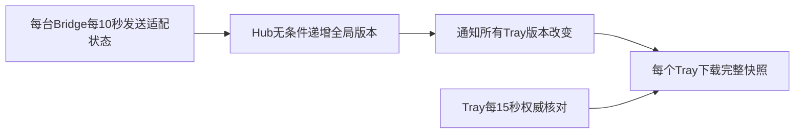

# 通讯流量评估

评估日期：2026-11-20。范围为公开RC4及0.6.0首候选的Tray、Bridge、Hub、Relay通讯；本页区分已确认实现与建议，不将待确认方案写成现行协议。实例地址、在线状态、原始采样和真实载荷规模保留在忽略的临时目录。

## 结论与当前边界

当前HTTP加WebSocket的技术选择能够满足状态提醒需求，主要问题出在刷新触发和传输粒度：适配器状态报告使全局版本不断递增，Tray收到版本变化后重新读取完整快照；没有业务变化时也每15秒读取完整快照。默认时间线的关键事件筛选只影响详情分页，不减少后台快照流量。

代码对照确认，状态报告、全局变化通知、Tray主同步和15秒权威快照逻辑在公开RC4与0.6.0首候选之间未变。这是既有通讯行为在移动网络下暴露的问题，不能归因于本次适配包下载或身份核对。Antigravity新增的身份核对游标和轮次信息仅在本机流转，不直接增加网络字段。

本轮只做读取、源码核对、HTTP载荷测量和既有TCP计数器采样；没有修改生产服务、降低采集可靠性或建立新的产品连接。针对该问题的源码修复、版本重建与部署尚未实施。

## 现行通讯方式

| 路径 | 内容与触发 | 流量特征 |
| --- | --- | --- |
| Tray到Hub，失败时到Relay | 常驻WebSocket，10秒心跳，接收hello和changed中的run_id/version；HTTP提交已读及获取快照 | WebSocket变化消息很小，但新版号会触发整个快照下载。详情窗口是否打开不影响主同步 |
| Tray快照 | 首次连接、版本变化、本地同步操作，以及距上次权威快照15秒时GET /api/v1/snapshot | 返回全部会话摘要、来源、在线设备及全部未读事件正文；不是只返回改变的会话，也不是最近30条 |
| Tray详情 | /api/v1/events按会话筛选并分页，每页30条，按持久位置取得新增内容 | 已有按需/增量查询；但选中的详情关闭仅隐藏，自动新增检查没有可见性条件，可能继续请求该会话的新事件 |
| Bridge到Hub，失败时到Relay | 每个原生事件单独HTTP投递；失败指数退避，已确认事件去重 | 原生事件的真实新增载荷通常较小；网络故障下的重传按原可靠性边界保留 |
| Bridge在线状态 | 独立WebSocket，10秒心跳；当前也接收全局版本变化，但回调不拉快照 | 主要是小消息，不是大型快照下载者 |
| Bridge适配状态 | 每10秒POST /api/v1/adapters/status；即使安装/运行/错误没有变化仍发送 | 报告本身较小，但Hub无条件更新报告时间、UPSERT并递增全局版本，唤醒所有订阅客户端 |
| Bridge适配包检查 | 默认300秒加0至59秒随机间隔检查签名索引 | 已安装同版本同摘要不重复下载包；有新版本才按256KiB分块下载。索引与状态上报周期不是同一个周期 |
| Hub到Relay | Hub主动建立WebSocket隧道，代理客户端请求/响应及订阅；Relay持久化未交付事件/已读 | Relay不保存会话快照副本、不替客户端去重整份快照。隧道JSON中的二进制body经Base64编码，该开销属于Hub与Relay之间的链路 |
| 路径恢复 | Tray在Relay成功连接30秒后也退出当前连接重试直连；Bridge的Relay观察连接同样30秒限时 | VPN或直连不可用时会重复握手、登记和刷新；可能放大全量同步，也影响来源连接代次 |

HTTP JSON响应当前无压缩协商实现；snapshot明确no-store，未提供条件响应。Relay目前只转发Range请求头，以及Content-Type、Content-Range、Accept-Ranges、ETag等少量响应头。压缩优化必须明确在哪一层执行，并核对Relay头部转发，不能只给Hub加压缩就宣称两条通路都已优化。

## 已确认的放大链条

适配状态不在Tray会话快照内容中，却仍引起该快照重新下载。多个Bridge的报告时间通常错开，客户端可能为不同报告分别取回相同内容；当前没有足够的请求合并。无正文运行事件、提醒有效期变化和连接/设备变化也共用同一版本；真实活动越密集，完整快照请求越频繁。

快照包含未读正文，并保留会话摘要集合；即使当前未读全部清空，已有会话摘要仍反复传输。减少事件列表展示条数或将已读阈值从3秒改为1.5秒，不能消除这个固定成本。归档会话由展示层过滤，也不能当作网络减流方案。

示例量级（为便于复核的假设，不代表精确复盘某台设备账单）：

- 快照30KB、5台Bridge各10秒报告一次、每次版本变化都重新拉取：每个Tray约15KB/秒，8小时约432MB；实际合并、活动和网络重传会改变结果。
- 即使切断适配报告触发，仍保留15秒无条件快照：相同30KB快照8小时约57.6MB。
- 以上两项不是简单相加：正常版本变化引起的快照会重置15秒计时。
- 升级包属于一次性流量；日常重复快照随在线时长持续增长。VPN、TLS、TCP/IP开销及丢包重传在上述应用载荷之外。

## 整体优化建议，待确认后实施

在所有安装实例可统一更新的条件下，推荐将本轮范围确定为完整对象增量、正文缓存、断线续接、Bridge上行与状态报告、Relay路径及载荷、按需历史、标准压缩与字节统计。减少无效刷新和压缩仍是其中的必要步骤，但不能作为整体效率优化已经完成的判据。

路线比较、现行交付保证、Relay共同升级要求和验收口径见[通讯整体优化选型建议](communication-optimization-proposal.md)。当前选型仍待确认，尚未改写生产协议。现有HTTP/WebSocket继续作为推荐技术基础，不新增消息平台；大载荷编码和压缩阈值在确认路线后测量确定。

管理网页也会对每条changed（包括同版本心跳应答）拉取snapshot、适配报告、推送记录和主机列表四个接口，另有15秒定时刷新。当前移动流量问题的归因须先确认网页是否打开；后续修复需要检查这一使用相同通知机制的入口，避免把流量问题留在管理页。

## 验证方法与完成条件

- 复现使用5至7个Bridge、约百个历史会话、多个Tray；在没有业务变化时量化完整快照次数和实际应用收发字节，不能仅看HTTP次数或CPU。
- 整体优化后，无变化状态不重复下载完整正文；事件、已读、来源离线与恢复均能及时反映。建议把稳定连接空闲8小时每台含Tray与两个Bridge的应用层通讯控制在8MB以内作为预算目标，升级包另计；最终阈值结合明确统计口径确认。
- 有活动场景分别测短任务密集事件、32KiB正文、大量未读、详情打开/隐藏；记录延迟、总字节及压缩比例，避免以删除历史、自动已读或少推通知达到指标。
- 同时验证直连、Relay、直连恢复、断线和丢包；保留重连先补已读再快照、Relay202仅表示暂存、Hub200才清理本地已读等现行保证。
- 以有限的按路径计数及收发字节统计作为证据，不记录Authorization、正文、会话标题或用户输入。生产历史缺少访问日志时应明确无法逐请求复盘，不将后续采样当作既往账单的精确证明。

## 代码入口

- Tray主同步：[sync.rs](../tray/src/sync.rs)；详情更新与隐藏：[main.rs](../tray/src/main.rs)、[sessions.rs](../tray/src/sessions.rs)。
- Bridge上报和包检查：[manager.go](../go/internal/adapters/manager.go)；事件投递与路径切换：[bridge.go](../go/internal/bridge/bridge.go)。
- Hub状态报告触发：[adapters.go](../go/internal/hub/adapters.go)；快照、全局版本：[store.go](../go/internal/hub/store.go)；订阅：[http.go](../go/internal/hub/http.go)。
- Relay代理：[relay.go](../go/internal/relay/relay.go)、[Hub隧道](../go/internal/hub/relay.go)；管理页：[App.vue](../web/hub/src/App.vue)。
